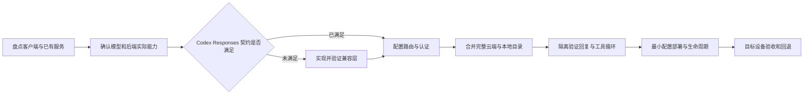

# Codex 保留云端模型并接入本地推理服务

这是给 AI 执行者使用的通用接入流程。目标是在保留 Codex 原有云端模型、认证和默认选择的同时，增加目标设备实际可用的本地模型。

后端可以是 vLLM、SGLang、llama.cpp、NInfer、Ollama、LM Studio 或其他推理服务。**模型种类、数量、上下文、输出上限、推理强度和思考预算都由目标后端、模型与版本决定，不预设固定值。** 这里列举后端不表示它们的所有版本都满足 Codex 的接口要求。

从 [AI 执行入口](docs/00-AI-HANDOFF.md) 开始，按 [通用安装流程](docs/03-INSTALL.md) 操作，最后填写 [设备验收报告](examples/installation-report.md)。两台设备分别盘点、适配和验收，不共享凭据或直接复制配置。

## 通用流程

关键是验证实际服务能力。OpenAI-compatible、一个 `/models` 列表或 Chat Completions 的成功回复，都不足以证明 Codex 可用。Codex 面向的入口需要满足当前客户端使用的 Responses、流式、工具和历史语义。

## 文档入口

|入口|内容|
|---|---|
|[AI 执行入口](docs/00-AI-HANDOFF.md)|可直接转发的安装指令|
|[架构](docs/01-ARCHITECTURE.md)|模型、推理引擎、协议、路由、目录和进程的关系|
|[方案演进](docs/02-HISTORY.md)|如何从原机经验抽取通用流程|
|[通用安装](docs/03-INSTALL.md)|跨平台盘点、隔离验证、部署和交付|
|[后端协议](docs/04-LOCAL-RESPONSES.md)|原生 Responses 与协议转换的接入分支|
|[模型目录](docs/05-CATALOG.md)|保留云端条目，按实际能力添加本地模型|
|[验收](docs/06-VERIFICATION.md)|任意数量模型、参数、工具及离线行为|
|[故障排查](docs/07-TROUBLESHOOTING.md)|按失败层定位问题|
|[回退](docs/08-ROLLBACK.md)|恢复原有云端和客户端配置|
|[来源与边界](docs/09-SOURCES-AND-LIMITS.md)|官方资料、历史实测和当前未实测项|
|[后端适配矩阵](docs/10-BACKEND-COMPATIBILITY.md)|vLLM、SGLang 等后端的核对方法|
|[推理和参数](docs/11-REASONING-AND-PARAMETERS.md)|无推理控制、默认值、强度、开关和预算|
|[路由实现要求](reference/README.md)|供 AI 生成目标机实现的契约|
|[NInfer Windows 案例](cases/ninfer-windows/README.md)|原机历史源码、配方和证据，按需参考|

## 两个层次

主目录的流程、模板和工具适用于不同后端。路由清单、能力探测和用户已有配置决定最终实现，不要求安装特定 Manager 或改用某个模型。

`cases/ninfer-windows/` 保存原机 NInfer 个案。里面的端口、两个预算别名、思考参数、Windows 启动器和模型元数据只属于那个案例，不能当成主流程默认值。案例源码不是通用多后端网关安装包。

## 分发给其他设备

设备取得本私有仓库读取权限后，可将以下文字发给各自的 AI：

> 读取 AGENTS.md、docs/00-AI-HANDOFF.md 和 docs/03-INSTALL.md。在当前设备保留 Codex 云端模型，接入已有或选定的本地推理服务。后端和模型不限。先盘点版本、接口、模型、认证与能力，再决定是否需要兼容层；不照搬案例的模型数量、推理强度或预算。隔离验证后最小部署，并逐项报告真实验收结果。

这是一份通用流程和实现契约，不是宣称已在所有引擎上跑通的一键安装器。本次修改没有在目标设备安装模型，也没有重启原机服务。
