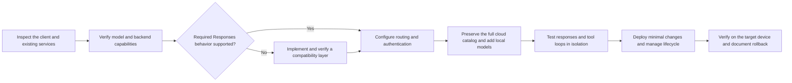

# Use cloud and local models in Codex

English | [Chinese](README.zh-CN.md)

A practical workflow for adding local inference services to Codex while keeping your existing cloud models, authentication, and default model. Written for users and AI assistants carrying out the installation on each device.

The workflow can be adapted to **vLLM, SGLang, llama.cpp, NInfer, Ollama, LM Studio, and other inference services**. Compatibility depends on the actual backend version, model, API, and deployment configuration. Listing a backend here does not mean every version or model has been tested with Codex.

Model names, model counts, context limits, output limits, reasoning controls, and thinking budgets are determined on the target device. The guide does not impose a particular model or reasoning preset.

## What this repository provides

- A workflow for inspecting an existing setup, checking capabilities, adapting protocols, configuring routes, and preserving cloud access.
- Guidance for models with no reasoning controls, models that use their own defaults, and models with verified effort levels, switches, budgets, or presets.
- Templates for device inventories, model routes, provider configuration, and installation reports.
- Verification steps for real streamed responses, tool calls, conversation history, authentication boundaries, offline behavior, and rollback.
- A historical Windows NInfer case with source snapshots and recorded evidence, kept separate from the general workflow.

This repository provides documentation, templates, and implementation requirements. It is not a universal installer or a ready-made gateway for every backend. It does not distribute model weights, runtime binaries, credentials, or account sessions.

## How the workflow works



The endpoint used by Codex must satisfy the Responses behavior required by the actual client, including streaming, tools, and conversation history. An OpenAI-compatible label, a model list, or a successful Chat Completions request alone does not establish that compatibility. Where necessary, the workflow calls for a verified protocol conversion layer.

Cloud and local authentication remain separate. Existing cloud defaults and unrelated client settings are preserved. Shared inference services should not be stopped simply because one Codex window closes.

## Get started

The detailed installation documents and templates are currently written in Chinese. This English overview links to those documents; it does not imply that the complete guide has been translated.

1. Read the [instructions for installation agents](AGENTS.md) and [AI handoff](docs/00-AI-HANDOFF.md).
2. Follow the [general installation workflow](docs/03-INSTALL.md).
3. Check the [backend compatibility matrix](docs/10-BACKEND-COMPATIBILITY.md) and [reasoning and parameter rules](docs/11-REASONING-AND-PARAMETERS.md) for each model.
4. Verify the actual deployment and complete the [installation report](examples/installation-report.md).

Each device needs its own inventory, credentials, configuration, and evidence. Do not copy another device's account files or assume that a historical case proves compatibility on a new setup.

## Documentation map

| Document | Purpose |
|---|---|
| [AI handoff](docs/00-AI-HANDOFF.md) | Instructions to give an AI assistant on the target device |
| [Architecture](docs/01-ARCHITECTURE.md) | Models, engines, protocols, routing, catalogs, and lifecycle |
| [Design history](docs/02-HISTORY.md) | How the original case became a general workflow |
| [Installation](docs/03-INSTALL.md) | Inspection, isolated testing, deployment, and delivery |
| [Protocol integration](docs/04-LOCAL-RESPONSES.md) | Native Responses support and conversion requirements |
| [Model catalogs](docs/05-CATALOG.md) | Preserve cloud metadata and add accurate local entries |
| [Verification](docs/06-VERIFICATION.md) | Check real model, tool, parameter, and offline behavior |
| [Troubleshooting](docs/07-TROUBLESHOOTING.md) | Identify the failing layer before changing the setup |
| [Rollback](docs/08-ROLLBACK.md) | Restore the original cloud connection and configuration |
| [Sources and limits](docs/09-SOURCES-AND-LIMITS.md) | Separate documented capabilities from measured results |
| [Backend compatibility](docs/10-BACKEND-COMPATIBILITY.md) | Inspect vLLM, SGLang, and other services by actual capability |
| [Reasoning and parameters](docs/11-REASONING-AND-PARAMETERS.md) | Handle defaults and supported controls without fixed presets |
| [Implementation requirements](reference/README.md) | Requirements for a target-specific router or compatibility layer |
| [Historical NInfer case](cases/ninfer-windows/README.md) | Original Windows example, source snapshots, and evidence |

The files under `cases/ninfer-windows/` describe one historical deployment. Its ports, model aliases, budgets, metadata, and Windows startup components are case-specific examples, not defaults for other backends.

## Give this task to an AI assistant

```text
Read AGENTS.md, docs/00-AI-HANDOFF.md, and docs/03-INSTALL.md.
Keep this device's existing Codex cloud models, authentication, and default model.
Inspect the chosen local backend, version, models, APIs, and capabilities first.
Use native Responses support where verified, or implement and test the required compatibility layer.
Do not copy the historical case's model count, reasoning levels, budgets, ports, or hardware settings.
Test in isolation before deploying minimal changes. Do not interrupt shared services or expose credentials.
Report real results, failures, untested features, and rollback steps for this device.
```

## Verify the repository

With Python 3.11 or later, run:

```text
python scripts/validate-repository.py
```

This checks documentation links, example formats, source snapshot hashes, and publication exclusions. It does not run model inference or certify a target deployment. Backend compatibility and installation results must be established on each target device.
