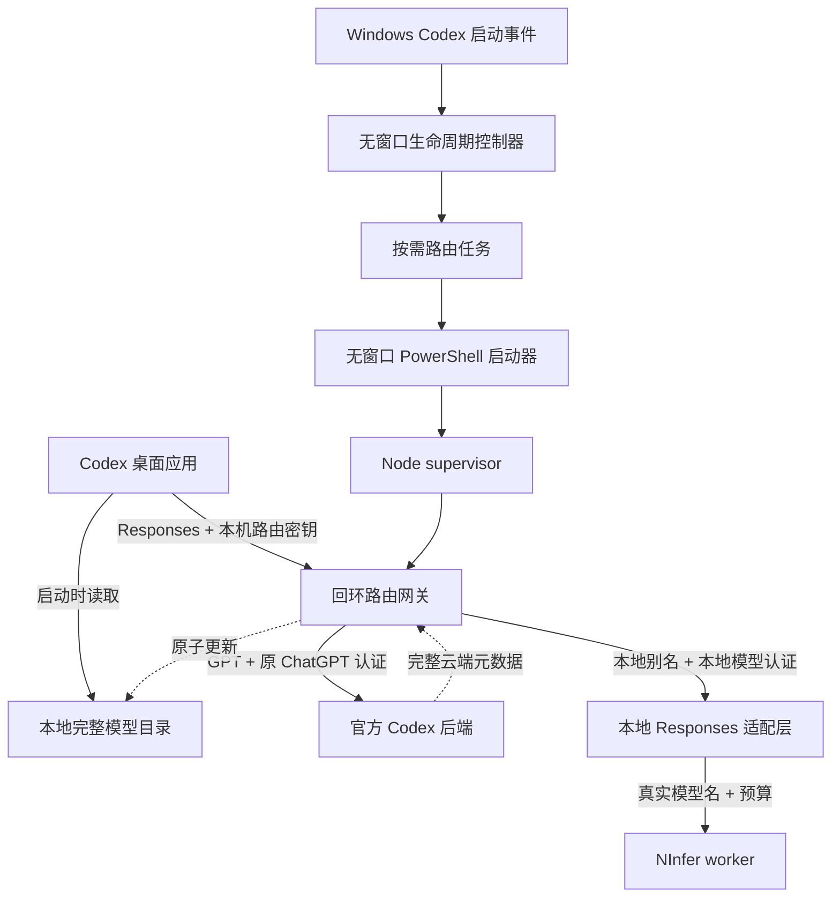

# 架构与边界

## 为什么统一 provider

原机独立 CLI profile 可以选择本地 provider，但桌面菜单中的模型别名不等于 provider 切换。同一个本地别名在 ChatGPT/openai 路由下曾被拒绝。当前方案让桌面只使用一个自定义 provider，由本机网关按请求里的 model 分流。

这保留的是云端模型选择、云端执行与用户自己的 ChatGPT 订阅认证，不表示云端请求绕过本机网关。**当前全局 provider 下，网关离线时云端推理也会失败。** 本地目录只解决菜单读取，不替代推理服务。

## 原机地址与请求

|层|原机值|可移植要求|
|---|---|---|
|Codex provider|`cloud-local-router`|可改名，所有引用一致|
|网关|`http://127.0.0.1:18767/backend-api/codex`|目标机检查占用，只绑定回环|
|云端|`https://chatgpt.com/backend-api/codex`|沿用正式 ChatGPT 登录路径|
|本地|`http://127.0.0.1:7777/v1`|必须是真实可用的 Responses 服务|
|目录|`$CODEX_HOME/local-ninfer/router/catalog-cache.json`|写入实际绝对路径|

参考网关接受 `/models`、`/responses` 和 `/responses/compact` 路径，采用 HTTP SSE，provider 设置 `supports_websockets=false`。接受路径不证明所有后端都实现 compact；目标机要另验长对话压缩与继续对话。

## 三种独立认证

1. Codex 到本机网关使用每台设备独立的随机 `X-Codex-Local-Router-Key`。
2. 云端分支继续携带 Codex 发出的 ChatGPT Authorization 和账号头。网关不从磁盘读取 ChatGPT 登录令牌。
3. 本地分支移除 Authorization、Cookie、`chatgpt-*`、`openai-*`，再写入本地模型的认证；路由密钥也不转发到上游。

参考代码从目标用户的 OpenCode `llama-wm` provider 读取本地模型认证。这是原机集成条件，不是要求安装 OpenCode。没有该配置的设备应将 `localCredential()` 适配为读取目标机自己的受保护本地密钥文件，并实测，不要建立假的 OpenCode 全量配置来迁就源码。

健康检查匿名可访问，其余请求要求路由密钥。带浏览器 Origin 的请求被拒绝。网关不记录提示词、请求体或认证头，但其他组件的日志仍须单独检查后才能分发。

## 模型与预算

|别名|思考预算|总输出上限|推理强度|
|---|---:|---:|---|
|`ninfer-minsi`|16384|24576|`xhigh`|
|`ninfer-qiongli`|32768|40960|`xhigh`|

两个别名在原机指向同一个实际模型，改变的是请求预算。NInfer 适配层将别名替换成 worker 实际模型名。预算不是性能排名，也不保证模型每次用完预算；控制 token 与实际思考 token应分开理解。

## 后台生命周期

当前方案中，`Codex Cloud Local Router` 无登录、无每分钟触发器；`Codex Router App Lifecycle` 监听 Codex 应用激活事件。应用运行时恢复网关，最后一个当前 Windows 会话里的 Codex 应用进程退出 15 秒后停止路由。Manager 与 NInfer 的启停单独管理。

CLI、IDE 等共享同一全局 provider 的客户端不在该桌面生命周期计数里。若需要桌面关闭后仍使用它们，应选择单独云端直连 profile，或另行设计覆盖这些客户端的生命周期，不能直接声称当前控制器已支持。
