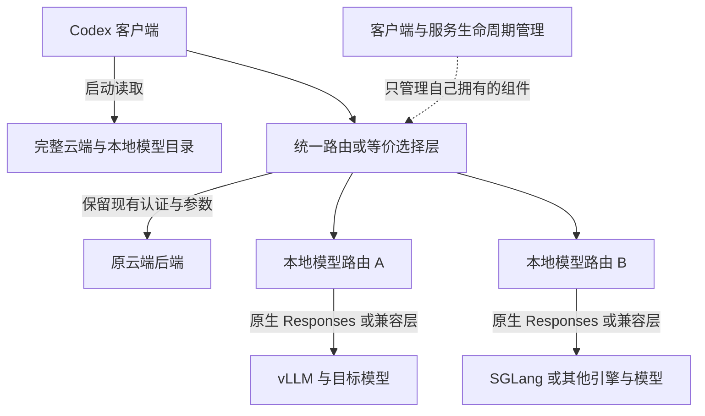

# 通用架构

模型是权重与能力，vLLM/SGLang 等是推理引擎，API 是对外协议，Codex 目录是客户端元数据。四者需要分别确认，不能用其中一个的名字代替其他三个的能力检查。

## 六项独立配置

|配置|要回答的问题|
|---|---|
|模型|实际加载了什么模型、修订和量化？客户端别名映射到哪个实际 ID？|
|引擎|什么后端和版本？运行在本机、WSL、容器还是授权服务器？|
|协议|原生 Responses 还是其他 API？需要哪些兼容转换？|
|能力和参数|支持哪些模态、工具、历史、上下文、输出和推理控制？|
|客户端目录|如何按当前 Codex schema 如实表示这些能力并保留云端？|
|生命周期|谁负责启动、健康、恢复和停止？服务是否被其他客户端共享？|

## 保留云端的路由选择

本仓库的统一菜单方案使用一个 Codex 自定义 provider，由路由层按明确的模型映射选择上游。模型别名本身不代表 provider 会自动切换。

路由表应显式区分云端和本地，不根据模型名是否以 GPT 开头推断目标。未知模型应返回清楚错误，不能静默转至默认云端。若目标客户端已有其他经过验证的多 provider 选择方式，可采用等价路径，但必须验证真正的客户端行为。

云端采用原有登录和参数规则。使用 ChatGPT 登录时，单独的网关认证与 ChatGPT 认证各司其职；云端使用 API 密钥时沿用对应机制，不强制改成 ChatGPT 登录。

本地认证来自本地服务自身，可为受保护密钥、网关凭据或受控回环服务的明确无认证模式。进入本地分支前必须移除云端令牌、账号信息和不应转发的网关头。不要为了适配案例而要求安装 OpenCode 或特定 Manager。

## 参数与目录

目录宣告能力，路由/兼容层落实请求映射，后端实际执行参数。这三个位置要一致。只有模型支持且经过验证的参数才可以映射。云端参数不受本地规则影响，不将一个模型的设置套给另一个模型。

统一目录保留完整云端元数据，再添加任意数量的本地条目。别名、上游模型和可选 preset 分开记录；一个模型无需为了接入而拆成多个强度别名。

## 生命周期与部署位置

选择已有服务管理器、systemd、容器编排或平台任务机制，使服务行为与使用范围一致。Windows 无窗口随桌面启停只是一种实现案例。

客户端关闭可以停止自己专用的路由，但不能因此停止共享 vLLM/SGLang 等后端。后台恢复不能反复终止正常请求。CLI、IDE、多窗口和其他客户端都应纳入实际生命周期设计，而不是只观察一个桌面窗口。

本地网关默认绑定回环。跨主机/容器/WSL 路径要确认地址、认证与边界；每个环境的 localhost 不自动代表同一台服务。已有受管远程网关按其 HTTPS 与访问策略接入，不擅自开放新的外网监听。
